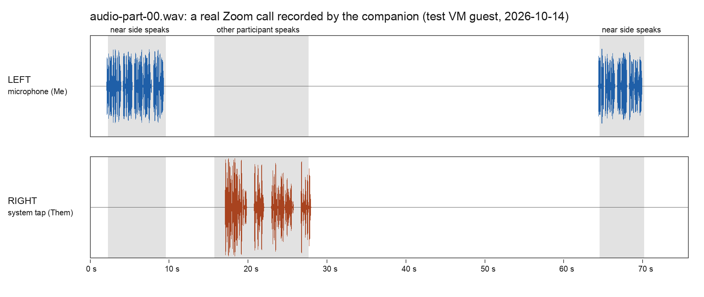

# RichOS macOS companion — CEO real-capture test protocol (P2)

The one verification step that **cannot be done anywhere but a real Mac with a human at the
keyboard**: proving the Core Audio process tap actually records live system audio into the frozen
contract, and that every failure mode behaves per the never-silent guarantee.

The reason this is yours and not ours is narrow and worth stating, because it is the only reason:
**the "System Audio Recording" permission is a GUI grant, and macOS provides no API to request it
non-interactively and no API to query whether it is held.** Everything either side of that gate is
already proven on this Mac and is reproduced below with its real output, so you are not re-testing
our work — you are closing the one hole.

Expect **~25 minutes**. Nothing here goes to a network. No account, no cloud.

> **RUN 2026-10-14 — the team ran this whole protocol itself, no human at the keyboard.** Every
> check below carries its result as a **RESULT** line. Where: a disposable test VM guest
> (macOS 15.7.7, build 24G720) booted with no sound device, so nothing was played aloud anywhere;
> BlackHole 2ch is the guest's microphone and BlackHole 16ch its speakers, which is what
> "headphones" means in section 3. How: every protocol command ran in the guest's own **Terminal**
> window (a `.command` file opened with `open -a Terminal`), so macOS saw exactly what it sees at a
> desk. **The permission was not written into the permission database:** macOS's own dialogs came
> up and were answered by pressing their Allow button through the guest's accessibility tree, the
> way a click does. Ctrl-C is SIGINT to the companion's own pid, which is what Terminal sends on
> Ctrl-C. Section 3 is a real native Zoom call against the Windows call lab's host PC, whose
> recorded speech is "the other participant". Binary: built from richos `9c5e1274a` with
> `swift build -c release`, sha256 `8771b38f5a6f1355…defc26b`, ad-hoc linker-signed. The walk that
> ran it is `tools-private/windows-call-lab/mac-guest/tap-protocol-walk.py` in the private record
> repository (richos-hq), its evidence in that repository's
> `docs/verification/2026-10-14-macos-tap-protocol/`. Five runs were made; results below are the
> fifth (guest `walk-7af0d0876186`), the first in which every step ran as written; what the first
> four taught is in that record.
>
> **Verdict:** sections 0, 1, 2, 3 and 4c **PASS**; **4a and 4b FAIL as written** (two companion
> defects, listed in section 5 with the four observations and the screenshot).

> **Where the recording goes.** By default the companion writes to
> `~/RichOS/corpus/ceo/evidence/unfiled/meetings` — your corpus, deliberately **outside** this
> repository, which ships publicly. Sections 1–4 below use a scratch zone instead, so nothing from
> this test lands in your real corpus. Both are outside the repo; the companion now **refuses** an
> in-repo zone rather than recording into one.

---

## 0. One-time setup

**0.1 — Toolchain.** Xcode command line tools give you Swift. Check:

```
swift --version
```

PASS: any `Apple Swift version 5.9` or newer.
FAIL: `xcode-select: note: no developer tools were found` → run `xcode-select --install`, then retry.

> **RESULT 2026-10-14 — PASS.** The build machine: `Apple Swift version 6.2.4
> (swiftlang-6.2.4.1.4 clang-1700.6.4.2)`. The guest: `Apple Swift version 6.1.2
> (swiftlang-6.1.2.1.2 clang-1700.0.13.5)`, developer tools at `/Library/Developer/CommandLineTools`.

**0.2 — Build (Release).** From this directory:

```
cd richos/tools/richos-service/companion-macos
swift build -c release
```

PASS: the last line is `Build complete!` and `.build/release/richos-companion` exists.
FAIL: any `error:` line — stop and send it; that is a code defect, not an environment one.

> **RESULT 2026-10-14 — PASS.** `Build complete! (9.18s)`, built on the host and copied into the
> guest at this directory's own `.build/release/richos-companion`. `codesign -dv` in the guest:
> `Identifier=richos-companion`, `flags=0x20002(adhoc,linker-signed)`, `Signature=adhoc`,
> `TeamIdentifier=not set`, `Info.plist=not bound`.

For brevity below:

```
rc=.build/release/richos-companion
```

**0.3 — Unit tests.** These need no permission and no audio hardware:

```
swift test
```

PASS: `Executed 36 tests, with 0 failures`.
*(VERIFIED 2026-08-29, macOS 15.6, Swift 6.1.2 — 36/36.)*

> **RESULT 2026-10-14 — PASS.** `Executed 60 tests, with 0 failures (0 unexpected)`. The suite has
> grown since August; 36 above is the old count, not a missing 24.

**0.4 — Environment report.**

```
$rc doctor
```

VERIFIED output on this Mac, 2026-08-29 — yours should differ only in paths and macOS version:

```
RichOS macOS capture companion 0.1.0-p2
macOS: 15.6.0
Core Audio process tap (>= 14.4): AVAILABLE
Product repo: /Users/…/richos
Drop zone: /Users/…/RichOS/corpus/ceo/evidence/unfiled/meetings
  source: corpus default
  (set RICHOS_DROP_ZONE, or LORO_CORPUS, to put sessions somewhere else)
  NOTE: does not exist yet — `capture` creates it on first run.
pipeline dep ffmpeg: /opt/homebrew/bin/ffmpeg
pipeline dep whisper-cli: /opt/homebrew/bin/whisper-cli
```

PASS: `AVAILABLE`, and both pipeline deps resolve to a path.
FAIL: `UNAVAILABLE — needs macOS 14.4+` → this protocol cannot run on that machine; stop and say so.
PARTIAL: `pipeline dep … : not found` → capture and the contract still work; only the transcript
steps (1.3, 3.5) are skipped. `brew install ffmpeg whisper-cpp` if you want them.

> **RESULT 2026-10-14 — PASS**, in the guest's Terminal:
>
> ```
> RichOS macOS capture companion 0.1.0-p2
> macOS: 15.7.7
> Core Audio process tap (>= 14.4): AVAILABLE
> Product repo: /Users/admin/lab/richos
> Drop zone: /Users/admin/RichOS/corpus/ceo/evidence/unfiled/meetings
>   source: corpus default
>   (set RICHOS_DROP_ZONE, or LORO_CORPUS, to put sessions somewhere else)
>   NOTE: does not exist yet — `capture` creates it on first run.
> pipeline dep ffmpeg: /Users/admin/testvm/walk-7af0d0876186/engine/runtime/bin/ffmpeg
> pipeline dep whisper-cli: /Users/admin/testvm/walk-7af0d0876186/engine/runtime/bin/whisper-cli
> ```
>
> (`ffmpeg`, `whisper-cli` and `node` are the RichOS engine's own runtime, on the window's `PATH`.)

**0.5 — A scratch drop zone,** so this test cannot touch your real corpus. Use one terminal window
for the whole protocol and set it once:

```
export RICHOS_DROP_ZONE="$HOME/richos-companion-test"
```

Re-run `$rc doctor` and confirm `source: RICHOS_DROP_ZONE` and the new path. If it still says
`corpus default`, the variable did not reach the process — you are in a different window.

> **RESULT 2026-10-14 — PASS.** `Drop zone: /Users/admin/richos-companion-test`,
> `source: RICHOS_DROP_ZONE`.

---

## 1. Headless contract proof — no permission needed

This proves the contract writer, the frozen L/R channel mapping, and the handoff to the
transcription pipeline **on your machine**, before any permission is involved. If this fails, stop:
the problem is not TCC.

**1.1 — Make two one-sided samples.** Any two mono 16-bit WAVs work; these are easy:

```
say -v Samantha -o /tmp/mic.aiff  "left channel me this is the microphone side of the recording"
say -v Daniel   -o /tmp/sys.aiff  "right channel them this is the system audio side of the recording"
ffmpeg -y -loglevel error -i /tmp/mic.aiff -ac 1 -ar 48000 -c:a pcm_s16le /tmp/mic.wav
ffmpeg -y -loglevel error -i /tmp/sys.aiff -ac 1 -ar 48000 -c:a pcm_s16le /tmp/system.wav
```

> **RESULT 2026-10-14 — PASS.** Both files made: `/tmp/mic.wav` 299,198 bytes, `/tmp/system.wav`
> 332,478 bytes. (`say -o` writes a file; nothing is played aloud.)

**1.2 — Push them through the real contract writer:**

```
$rc ingest --mic /tmp/mic.wav --system /tmp/system.wav
```

PASS looks exactly like this (the session id is a timestamp, so yours differs):

```
session (open) written: /Users/…/richos-companion-test/2026-08-29T16-40-18Z--system--call
session (closed) written: /Users/…/richos-companion-test/2026-08-29T16-40-18Z--system--call
run the P1 pipeline over it:  node ../bin/richos-service.js run "…"
```

The directory contains three files: `session.json`, `audio-part-00.wav`, `health.ndjson`.

FAIL: a `privacy invariant: refusing to write call recordings inside the RichOS product repo` line
and exit 1 → your `RICHOS_DROP_ZONE` points inside the checkout. Set it to something under `$HOME`.

Open `session.json` and confirm these five (VERIFIED values, 2026-08-29):

| Field | Expected |
|---|---|
| `schemaVersion` | `2` |
| `status` | `"closed"` |
| `capture.source` | `"desktop-companion-macos"` |
| `capture.method` | `"coreaudio-tap+mic"` |
| `capture.channels` | `left: "microphone (me)"`, `right: "system/tap (everyone else)"` |

and in `health.ndjson`, every row `"level":"green"`, `"tapRunning":true`, `"micRunning":true`,
`"bytesDelta"` non-zero, `"problems":[]`.

> **RESULT 2026-10-14 — PASS.**
>
> ```
> session (open) written: /Users/admin/richos-companion-test/2026-10-14T09-42-38Z--system--call
> session (closed) written: /Users/admin/richos-companion-test/2026-10-14T09-42-38Z--system--call
> run the P1 pipeline over it:  node ../bin/richos-service.js run "/Users/admin/richos-companion-test/2026-10-14T09-42-38Z--system--call"
> ```
>
> Three files (`audio-part-00.wav`, `health.ndjson`, `session.json`). `schemaVersion` 2, `status`
> `"closed"`, `capture.source` `"desktop-companion-macos"`, `capture.method` `"coreaudio-tap+mic"`,
> `capture.channels` `left: "microphone (me)"`, `right: "system/tap (everyone else)"`. Every health
> row green, `tapRunning` and `micRunning` true, `bytesDelta` non-zero, `problems` empty; the first
> reads `"micRms":0.724509,"sysRms":0.789422,…,"bytesDelta":192044`.

**1.3 — Transcribe it** (skip if 0.4 said a dep was missing):

```
node ../bin/richos-service.js run "$RICHOS_DROP_ZONE/<sessionId>"
```

PASS: the last line is `READY … -> …/transcript.md`, and that file reads — VERIFIED verbatim on this
Mac, 2026-08-29:

```
**[00:00] Me:** Left channel me this is the microphone side of the recording.

**[00:00] Them:** Right channel them this is the system audio side of the recording.
```

**`Me:` carries the mic line and `Them:` carries the system line. That is the whole contract**: left
is you, right is everyone else, no diarization model involved. If those two are swapped, stop and
report it — every downstream feature reads that mapping.

FAIL: `pipeline.status` stays `"pending"` and no `transcript.md` → paste the command's stderr.

> **RESULT 2026-10-14 — PASS.** Last line `READY 2026-10-14T09-42-38Z--system--call — 23 words ->
> …/transcript.md`, and the transcript reads, verbatim:
>
> ```
> **[00:00] Me:** Left channel me this is the microphone side of the recording.
>
> **[00:00] Them:** Right channel them this is the system audio side of the recording.
> ```
>
> `Me:` carries the microphone line, `Them:` the system line: not swapped.

---

## 2. The permission grant — and proving it was actually granted

This is the section the Windows half does not need and the reason this document exists.

### 2.1 What you are granting, and what it is called on your Mac

macOS 14.4+ has a **narrow** permission for capturing system audio without capturing the screen. On
macOS 15.6 the pane is **System Settings → Privacy & Security → System Audio Recording Only**
(*"Allow the applications below to access and record your system audio."*). It is a different pane
from **Screen & System Audio Recording**, which is the broad screen-recording permission. The
companion uses the narrow one and asks for nothing else besides **Microphone**.

*(The two pane names above were read out of this machine's own System Settings string table on
2026-08-29, not from memory.)*

### 2.2 Establish the "before" state — do this BEFORE you run capture

The whole point of this section is to be able to tell **granted** from **merely prompted**. That
needs a before and an after. macOS exposes no API for it, but the permission store is a SQLite file
you can read:

```
sqlite3 "$HOME/Library/Application Support/com.apple.TCC/TCC.db" \
  "select service, client, client_type, auth_value from access where service like '%AudioCapture%' or service like '%Microphone%';"
sqlite3 "/Library/Application Support/com.apple.TCC/TCC.db" \
  "select service, client, client_type, auth_value from access where service like '%AudioCapture%' or service like '%ScreenCapture%';"
```

VERIFIED on this Mac, 2026-08-29 — the "before" state, and it is the finding this whole item exists
for:

```
kTCCServiceMicrophone|com.apple.Terminal|0|2
kTCCServiceMicrophone|com.google.Chrome|0|2
…
```

and **not one `kTCCServiceAudioCapture` row in either database.** No application on this machine has
ever been granted — or even asked for — system-audio recording. That is exactly the gap.

Reading the columns:

- `auth_value` — **`2` = allowed**, `0` = denied. (Consistent with observed behavior here: every
  app that records audio on this Mac has `2`.)
- `client_type` — `0` = the client is a **bundle identifier**, `1` = an **absolute path**. Which one
  appears after you grant is load-bearing; see 2.5.
- **A missing row is not "denied". It means never asked** — and that is the state that makes
  "prompted" and "granted" indistinguishable without this query.

If either command errors instead of printing rows, your terminal lacks Full Disk Access. Either
grant it (System Settings → Privacy & Security → Full Disk Access → your terminal app) or fall back
to the GUI check in 2.4 alone, and say in your report that you did.

> **RESULT 2026-10-14 — PASS.** Before the first capture: **no `kTCCServiceAudioCapture` row and
> no row for Terminal or the companion in either database.** (The queries ran over the guest's
> SSH session, the system database with `sudo`; the only rows are the test image's own tooling:
> `osascript`, `org.python.python`, `tart-guest-agent`, `sshd-keygen-wrapper`, plus Zoom's
> microphone row, which the lab writes for its call client.)

### 2.3 Trigger the prompt

```
$rc capture
```

Expected first two stderr lines:

```
•  session (open) written: /Users/…/richos-companion-test/<sessionId>
•  capturing system audio + mic. Press Ctrl-C to stop.
```

Two dialogs should appear — **Microphone** and **System Audio Recording**. Allow both. Then press
**Ctrl-C** immediately; this run exists only to raise the prompts.

> **RESULT 2026-10-14 — PASS. Both prompts appeared, System Audio Recording first, and both
> name Terminal, not the companion.** Read out of the dialogs' own accessibility text:
>
> 1. **"“Terminal” Would Like Access To Record Your System Audio"**, buttons **Don’t Allow** and
>    **Allow** (and a Help button). On screen within 2.4 s of the capture starting; macOS's privacy
>    service logged `AUTHREQ_PROMPTING … service=kTCCServiceAudioCapture, subject=Sub:{com.apple.Terminal}`
>    with the companion as the accessing process (`identifier=richos-companion`, its binary path).
> 2. After Allow: **"“Terminal” would like to access the microphone."**, buttons **Don’t Allow**
>    and **Allow**, with no explanation line under it (Terminal carries none).
>
> The capture waits on the dialogs: its stderr says only the first line until both are answered,
> then (about 12 s after it started, the time the two presses took):
>
> ```
> •  session (open) written: /Users/admin/richos-companion-test/2026-10-14T09-43-04Z--system--call
> •  capturing system audio + mic at 48000 Hz. Send SIGINT to stop.
> ‼️  RichOS companion ALARM: The microphone is giving RichOS only silence; microphone access may be turned off for RichOS in System Settings.
> •  session (closed) written: /Users/admin/richos-companion-test/2026-10-14T09-43-04Z--system--call — the pipeline may now transcribe it.
> ```
>
> The second line's wording has changed since this file was written ("at 48000 Hz. Send SIGINT to
> stop." where it says "Press Ctrl-C to stop."). The ALARM is the guest's microphone being
> BlackHole with nothing playing into it: exact digital zeros, which a real microphone never
> delivers. Ctrl-C closed the session cleanly, exit status 0.

### 2.4 Confirm in the GUI

**System Settings → Privacy & Security → System Audio Recording Only.**

PASS: an entry is listed **with its toggle ON**.
FAIL — and this is the distinction that matters: an entry listed with the toggle **OFF** means you
were prompted and it was *not* granted (or was granted and later revoked). An **empty pane** —
*"Applications that have requested access to record your app audio will appear here"* — means the
prompt never reached TCC at all, which is a different failure with a different cause. Say which one
you see.

macOS may also show *"'X' may not be able to record the audio from running applications until it is
quit."* If it does: **quit the application it names** (your terminal, if that is what it says) and
reopen it before section 3. A grant that needs a relaunch and does not get one looks exactly like a
grant that did not take.

> **RESULT 2026-10-14 — PASS.** On macOS 15.7.7 the anchor opens one pane, **Screen & System Audio
> Recording**, with two lists. The lower one is **System Audio Recording Only**, *"Allow the
> applications below to access and record your system audio."*, and lists **Terminal with its
> toggle ON** (the upper, broad list does not contain Terminal). No "may not be able to record
> … until it is quit" message came up after this grant. (That kind of sheet does come up for the
> **Microphone** switch: see 4a.)

### 2.5 Confirm in the store — the check that cannot be fooled

Re-run **both** queries from 2.2.

PASS: a `kTCCServiceAudioCapture` row now exists with `auth_value` **`2`**.
FAIL: `auth_value` `0` → denied. Toggle it on in the pane from 2.4 and re-check.
FAIL: still no row at all → the prompt never reached TCC. Go to 2.6.

**Then read the `client` and `client_type` of that row and write both down.** This decides something
open item 1.1 (Apple signing) has been arguing about with no data:

- `client_type 0` with a bundle id like `com.apple.Terminal` → the grant belongs to your **terminal
  app**. Rebuilding the companion does not disturb it, and any binary you run from that terminal
  inherits it.
- `client_type 1` with the **path** to `richos-companion` → the grant is pinned to this ad-hoc
  binary, whose code-directory hash **changes on every `swift build`**. Then every rebuild costs you
  the grant, which is precisely the dogfooding cost that makes Developer ID signing a v1 blocker.

Either answer is useful. We currently do not know which one it is.

> **RESULT 2026-10-14 — PASS, and the answer is the first bullet.** In the user database, after
> the two presses:
>
> ```
> kTCCServiceAudioCapture|com.apple.Terminal|0|2
> kTCCServiceMicrophone|com.apple.Terminal|0|2
> ```
>
> **`client` = `com.apple.Terminal`, `client_type` = `0` (a bundle identifier), `auth_value` 2**
> (`auth_reason` 2, a person's answer to the prompt). Nothing was written to the system database.
> So the grant belongs to the terminal app, and by this section's own reading a rebuild of the
> companion does not cost it. That reading was not measured separately by rebuilding; it follows
> from a row that names no binary. It also means any program run from that terminal records system
> audio without asking. Inside the installed RichOS app the responsible process is RichOS itself
> (`com.richos.app`), which this protocol does not exercise.

### 2.6 If no prompt appeared and no row was created

Run capture again and watch stderr. There are exactly two shapes, and which one you see tells us
where the code is wrong:

**Shape A — it refuses to start.** The alarm text is fixed and will read:

```
‼️  RichOS companion ALARM: capture failed to start: AudioDeviceStart failed (OSStatus <n>). If this is the first run, grant "System Audio Recording" and Microphone in System Settings > Privacy & Security, then retry. The open session at … is the on-disk record that this call was NOT captured.
```

Send the **`<n>`**. *(UNKNOWN: nobody has seen this number. It is the OSStatus Core Audio returns
when starting a tap-bearing aggregate device without the grant, and it is the single most useful
byte in this whole document if the grant path is broken.)*

**Shape B — it starts and records silence on the right.** Capture runs, but the tap delivers no
frames. After 15 seconds you get:

```
‼️  RichOS companion ALARM: no audio has been written for 15s — the capture has stalled (tap stopped, device changed, or System Audio Recording permission was revoked). Session: …
```

(and a Notification Center banner). `health.ndjson` will show `"level":"red"` with the problem
string `system-audio tap stalled — silence-filling RIGHT (possible permission revocation)`.

Either way the session directory **exists on disk with `status:"open"`** — the never-silent
guarantee: a call that was not captured leaves a loud anomaly, never an absence. Confirm that it
does; that part is verifiable regardless of which shape you hit.

> **RESULT 2026-10-14 — NOT REACHED in the final run: a prompt appeared and the row was created.**
> Neither shape was seen, so there is **no OSStatus to report**: `AudioDeviceStart` never refused.
> Two earlier runs did show what happens while the prompt sits **unanswered** (the walk had failed
> to see it): a third shape. The capture neither fails nor records; it waits, printing only
> `session (open) written: …`, with no alarm (90 s in one run, 240 s in the other). Ctrl-C then ends
> it with exit status 130, because the SIGINT handler is installed only once capture has started,
> and `session.json` stays `"open"` with no audio (a 44-byte WAV header, an empty `health.ndjson`):
> the never-silent guarantee holds, but nothing tells the person why nothing is happening.

---

## 3. Live capture of a real call — the core test

Only attempt this once section 2 ends with `auth_value 2`.

1. Start a real **Zoom or Teams desktop** call — a test call with someone, or Zoom's test meeting at
   <https://zoom.us/test>, which plays audio you can talk over.
2. **Wear headphones for this run.** It proves the tap reads the render stream *before* the output
   device, so capture does not depend on sound coming out of the speakers. It also keeps the far
   side out of your microphone, which would make the L/R check meaningless.
3. Run:

   ```
   $rc capture
   ```

   PASS: `capturing system audio + mic. Press Ctrl-C to stop.`
   FAIL: `stand down: …` → a browser capture already owns this call. Re-run with `--force` if you
   want both, or close the extension's capture. (VERIFIED: with nothing else capturing, the
   coordination authority answers `"decision": "own", "reason": "no conflicting live capture"`.)

4. Talk for **60–90 seconds**, and make sure the other side talks too. Deliberately **take turns**
   rather than talking over each other — you need to be able to tell the channels apart by ear.
5. Press **Ctrl-C**. PASS:

   ```
   •  session (closed) written: … — the P1 watcher will now transcribe it.
   ```

**3.5 — Verify the capture.** In the session directory:

- `session.json` → `"status":"closed"`, `audio.bytesTotal` well above zero,
  `health.recordsWritten` ≈ the number of seconds you recorded, `health.worstLevel` `"green"`.
- `health.ndjson` → rows with `tapRunning:true`, `micRunning:true`, `bytesDelta` non-zero every
  second, and **`sysRms` above zero while the other person was speaking**. That number is the proof
  the tap actually received audio, as opposed to running happily and recording silence.
- **Open `audio-part-00.wav` in QuickTime, Audacity or Music, and listen with the balance hard left,
  then hard right.** **LEFT = your voice. RIGHT = the other participant.** This is the single most
  important check in this document, and it is the one no automated test can make.
- If the deps are installed, a `transcript.md` should appear on its own within a minute or so (the
  P1 watcher picks up closed sessions), or run
  `node ../bin/richos-service.js run "<dir>"`. Both sides should be attributed `Me:` / `Them:`.

FAIL, and what each means:

| What you see | What it means |
|---|---|
| RIGHT channel silent, LEFT fine | The tap ran but captured nothing — permission, or the tap is attached to the wrong device |
| LEFT silent, RIGHT fine | Microphone not granted or not running; `health.ndjson` will say `micRunning:false` |
| Both present but one lags the other progressively | Sample-rate drift between the mic and the tap. **UNKNOWN — never observed over a real call.** Note roughly how far apart they are by the end |
| Audio stops partway through, `bytesDelta` goes to 0 | The 15 s watchdog should have alarmed. Say whether it did |

> **RESULT 2026-10-14 — PASS. `CoreAudioCapture` ran over a real call: the tap, the aggregate
> device and the resampled microphone.** The call: native Zoom 7.2.2 in the guest, joined to a
> meeting hosted on the Windows call lab's PC, which played a recorded speaker into its own
> microphone ("the other participant"). The near side is a recorded voice played into the guest's
> microphone (BlackHole 2ch). Because the tap records every process's output, that player was
> passed as `$rc capture --exclude-pid <player pid>`: a person's voice is not system output, and
> without it the near side would land on RIGHT as well. Turns, on the capture's clock: near side
> 2.3–9.6 s, the other participant 15.8–27.7 s (the PC's playback clock), near side again
> 64.6–70.2 s.
>
> - **3.3 — PASS.** `•  capturing system audio + mic at 48000 Hz. Send SIGINT to stop.`, no
>   stand-down.
> - **3.5 Ctrl-C — PASS.** `•  session (closed) written: …/2026-10-14T09-45-18Z--system--call — the
>   pipeline may now transcribe it.` (the line now says "the pipeline may now", not "the P1 watcher
>   will now").
> - **`session.json` — PASS.** `"status":"closed"`, `audio.bytesTotal` 14,555,180,
>   `health.recordsWritten` 76 for 76.7 s recorded, `health.worstLevel` `"green"`.
> - **`health.ndjson` — PASS.** 76 rows, every one `tapRunning:true`, `micRunning:true`, green,
>   `bytesDelta` non-zero, no problems. **`sysRms` 0.45 to 1.00 in every second the other
>   participant spoke (18.5–28.5 s), at most 0.006 anywhere else**; `micRms` 0.59 to 0.76 while the
>   near side spoke, exactly 0 everywhere else. (`micRms`/`sysRms` hold each second's peak; the
>   RMS is in `micRmsMean`/`sysRmsMean`.)
> - **LEFT and RIGHT — PASS, measured instead of listened to.** Per-second peaks of
>   `audio-part-00.wav` itself: LEFT has sound in seconds 2–9 and 64–69 only, RIGHT in 17–27 only.
>   While the other participant spoke LEFT stayed below 0.01 of full scale, and RIGHT did the same
>   while the near side spoke. **LEFT = the near side, RIGHT = the other participant**, with
>   nothing of either on the other channel. The screenshot in section 5 shows it.
> - **Transcript — PASS** (run by hand: no P1 watcher runs in the guest). 54 words in 8 lines: the
>   5 `Me:` lines are exactly the near side's two turns, the 3 `Them:` lines exactly the other
>   participant's, none crossed. (The words are the lab's recorded fixtures and stay in the private
>   record.) One timing fault in the pipeline, outside this protocol: each side's first line is
>   stamped `[00:00]`, though the near side began at 2.3 s and the other participant at about 17 s.
>
> The failure table, row by row: RIGHT silent, no. LEFT silent, no. **Lag:** the companion's own
> counters of frames each side delivered (`micFrames`, `sysFrames`) ended this 76.7 s call 0.33 s
> apart, the tap behind; the same call in run 4 ended 0.72 s apart, growing steadily from −0.23 s;
> in run 3 they stayed 0.10 to 0.21 s apart with no growth. Why the tap fell behind in two of three
> calls is not established. That is delivered frames, not a
> sample-accurate timing of the WAV against an outside clock (the PC's and the guest's clocks are
> different clocks). Audio stopping partway: not seen, and no stall alarm came.

---

## 4. Failure modes — the never-silent guarantee

Each of these deliberately breaks something. Do them after section 3 succeeds; ~3 minutes each.

**4a — Microphone denied.** System Settings → Privacy & Security → **Microphone** → turn the
companion's entry (or your terminal's) **off**. Run `$rc capture`, play any audio for ~20 s, Ctrl-C.

PASS: the system side is still recorded on RIGHT; `health.ndjson` rows carry `"micRunning":false`,
`"level":"red"`, and a problem string about the microphone; LEFT is silent. **The far side of the
call is not lost.** Turn the permission back on afterwards.

> **RESULT 2026-10-14 — FAIL as written: the far side is kept, but the session never records that
> the microphone was off.** Terminal's switch in the Microphone pane was turned off through the
> accessibility tree (row `kTCCServiceMicrophone|com.apple.Terminal|0|0`). macOS then said, in a
> sheet: *"“Terminal” will have access to your microphone until it is quit. You can choose to quit
> “Terminal” now, or do it on your own later."* with **Later** and **Quit & Reopen**; Quit & Reopen
> was pressed, as this protocol's 2.4 advice would have it. Then a 22 s capture while a voice played
> into the microphone (its player kept out of the tap) and other audio played to the speakers:
>
> - **RIGHT recorded — PASS:** `sysRms` 0.08–0.09 in seconds 3–10, while the speakers played.
> - **LEFT silent — PASS:** `micRms` exactly 0 in all 24 rows, although the microphone was being
>   spoken into. The denial took effect.
> - **stderr ALARM — yes:** `‼️  RichOS companion ALARM: The microphone is giving RichOS only
>   silence; microphone access may be turned off for RichOS in System Settings.`
> - **`health.ndjson` — FAIL:** every row `"micRunning":true`, `"level":"green"`, `"problems":[]`;
>   `session.json` `health.worstLevel` `"green"`, `alerts` `[]`. The capture knows (it said so on
>   stderr) and the record does not: a session read later shows a healthy call with a silent side.
> - **Notification Center banner — none.** The banner list read at 12 s holds only macOS's own
>   items; no RichOS alarm, in this run or the two before it.
>
> Switching back on showed the mirror sheet, *"“Terminal” will not have access to your microphone
> until it is quit."*; Quit & Reopen again, and the row returned to `auth_value` 2.

**4b — No audio at all.** Run `$rc capture` with no call, nothing playing, and say nothing, for
~30 s. Ctrl-C.

PASS: after 15 s of no byte growth, the stderr **ALARM** about "no audio has been written for 15s"
plus a Notification Center banner; and the near-empty session is on disk with `session.json`
present. When the pipeline runs over it, it is flagged as an anomaly rather than silently dropped.

> **RESULT 2026-10-14 — FAIL as written: the 15-second alarm cannot fire here.** 36 s of capture
> with nothing playing and nothing on the microphone. Both sources keep delivering frames of
> silence, so the file grew every second (`bytesDelta` non-zero in all 36 rows) and the byte
> watchdog never reached 15. What did come, at about 10 s, is the microphone alarm from 4a:
> `‼️  RichOS companion ALARM: The microphone is giving RichOS only silence; microphone access may be
> turned off for RichOS in System Settings.`, which is wrong about the cause here (access was on;
> the guest's microphone is a virtual device giving exact zeros, which a real microphone never
> does). No Notification Center banner (the banner list read at 12 s has no RichOS item). Rows all
> green, `alerts` `[]`. The rest **PASSES**: the session is on disk with `session.json`, and the
> pipeline flags it, `pipeline.status` `"anomaly"`: *"captured audio is digitally silent on BOTH
> channels (me -91 dB / others -91 dB max) — nothing was actually recorded. The session closed but
> held no sound. Investigate the capture; never treat as a complete transcript."*

**4c — Crash mid-call.** Run `$rc capture`, record ~20 s of real audio, then **kill it hard** from a
second terminal — `pkill -9 richos-companion` — rather than Ctrl-C.

PASS: `session.json` is still `"status":"open"` (never finalized — a loud anomaly), **but
`audio-part-00.wav` is a valid, playable WAV** containing everything up to the last one-second flush.
Play it. Losing at most ~1 s is the guarantee; losing the file is a defect.

> **RESULT 2026-10-14 — PASS.** A voice played into the microphone, the capture ran, and 22.23 s
> after it started it was killed with SIGKILL (`kill -9` on its own pid, the process
> `pkill -9 richos-companion` names; Terminal printed `Killed: 9`). `session.json` is still
> `"status":"open"`. `audio-part-00.wav` is valid: its header declares 4,223,680 bytes of audio
> (1,055,920 frames, 2 ch, 48 kHz, 16-bit = 21.998 s), the file is exactly that plus the 44-byte
> header, and ffmpeg decodes all of it with exit status 0. Lost: 22.23 − 22.00 = 0.23 s, inside
> the 1 s guarantee. (In run 4 the header lagged the data on disk by 0.395 s, the frames written
> after the last flush; the file still decoded, to the header's 21.867 s.)

---

## 5. What to report back

For each of **1, 2, 3, 4a, 4b, 4c**: **pass / fail, plus one line.**

Four things are worth more than the pass/fail:

1. **The exact wording of the System Audio Recording dialog** (2.3) — and which application it named.
2. **The `client` and `client_type` of the `kTCCServiceAudioCapture` row** (2.5) — this settles
   whether a rebuild costs the grant.
3. **The `<n>` from `AudioDeviceStart failed (OSStatus <n>)`**, if you hit shape A (2.6).
4. **One screenshot**: `audio-part-00.wav` open in an audio editor, showing your voice on the LEFT
   track and the other participant on the RIGHT.

If anything deviates from "PASS", paste the stderr and the offending `session.json`. That is exactly
the signal that pinpoints a real-hardware defect no unit test can reach.

### Reported 2026-10-14 (test VM guest, macOS 15.7.7, richos `9c5e1274a`)

| Section | Result | One line |
|---|---|---|
| 1 | **PASS** | The contract writer, the L/R mapping and the transcription hand-off, exactly as on 2026-08-29 |
| 2 | **PASS** | Both prompts appeared and were allowed; the grant is a `kTCCServiceAudioCapture` row with `auth_value` 2 |
| 3 | **PASS** | A real Zoom call: the near side on LEFT only, the other participant on RIGHT only, 76.7 s, every health row green |
| 4a | **FAIL** | The far side is kept and LEFT is silent, but `health.ndjson` and `session.json` say green and healthy; only stderr knows |
| 4b | **FAIL** | The 15 s stall alarm cannot fire while silence is still written; a misleading microphone alarm comes instead; the pipeline does flag it |
| 4c | **PASS** | SIGKILL leaves `session.json` open and a valid WAV, 0.23 s short of the kill |

**The four observations:**

1. **The dialog** says **"“Terminal” Would Like Access To Record Your System Audio"**, buttons
   **Don’t Allow** and **Allow**. It names **Terminal**, the responsible app, not the companion.
   A second dialog follows: **"“Terminal” would like to access the microphone."**
2. **The row:** `client` **`com.apple.Terminal`**, `client_type` **`0`** (bundle identifier),
   `auth_value` 2, in the user database. The grant is the terminal's, so rebuilding the companion
   does not cost it (2.5's reading; not measured by an actual rebuild).
3. **The OSStatus:** none. `AudioDeviceStart` never refused; shape A was not hit. With the prompt
   left unanswered the capture simply waits (2.6).
4. **The screenshot:** `audio-part-00.wav` from section 3, drawn as an editor draws it, the near
   side on the LEFT track and the other participant on the RIGHT, with the turns shaded. It is
   drawn from the WAV's own samples by the lab's `wav-tracks.py`, not photographed in an editor's
   window (the guest has no audio editor):

   

**Defects found** (none fixed here; this run changes no product code):

- **D1 — the microphone-off state never reaches the record (4a).** The capture detects digital
  silence and says so on stderr, but every health row stays `micRunning:true`, green, no problem,
  and `session.json` has no alert. Anything that reads the session later (the pipeline, the app's
  notes) sees a healthy call.
- **D2 — no stall alarm for silence, and the wrong alarm instead (4b).** Silence frames keep the
  WAV growing, so the 15 s byte watchdog cannot fire when both sides go quiet; the microphone alarm
  fires instead and blames microphone access, which was on. (A real microphone's noise floor would
  keep this alarm quiet; the guest's virtual one does not.)
- **D3 — no Notification Center banner for any alarm.** The CLI posts alarms through `osascript
  display notification`; in three runs no RichOS item ever appeared in Notification Center's list.
- **D4 — an unanswered prompt leaves the capture waiting with no word (2.6).** It neither alarms
  nor gives up, and Ctrl-C then kills it uncleanly (exit 130) because its SIGINT handler is
  installed only after capture starts. The empty open session does keep the never-silent guarantee.
- **D5 — the two sides' delivered frames drift apart (3).** The tap delivered 0.33 s fewer frames
  than the microphone over this 76.7 s call and 0.72 s fewer in another; not in a third.
- **Pipeline, not companion:** each side's first transcript line is stamped `[00:00]` whatever
  time it was spoken.
- **This file's own text drifted:** 0.3's count (60 tests now), 2.3's and 3.5's expected stderr
  lines (both reworded).

---

## 6. What this protocol does NOT cover

Named here so nobody reads a completed run as more than it is:

- **Process-scoped capture.** The Windows half can scope the tap to one application's PID; this one
  always captures **all** system output. That is deliberate (architecture §10-Q2, "all-output
  first") and means anything else making noise — a notification, music — lands on the RIGHT channel
  alongside the call. `CATapDescription` supports an exclusion list; nothing uses it yet.
- **Extension ↔ companion failover.** Section 3 exercises the `claim` handshake in the trivial case
  only (nothing else capturing). Promotion of a dead browser session to the companion is P4.
- **Long calls.** The longest thing the contract writer has ever handled is measured in seconds.
  Nothing here says what an hour looks like — clock drift, file size, or memory.
- **A signed build.** Everything above runs an ad-hoc binary. What changes under a Developer ID
  signature is the subject of open item 1.1, and section 2.5 is the measurement that informs it.
